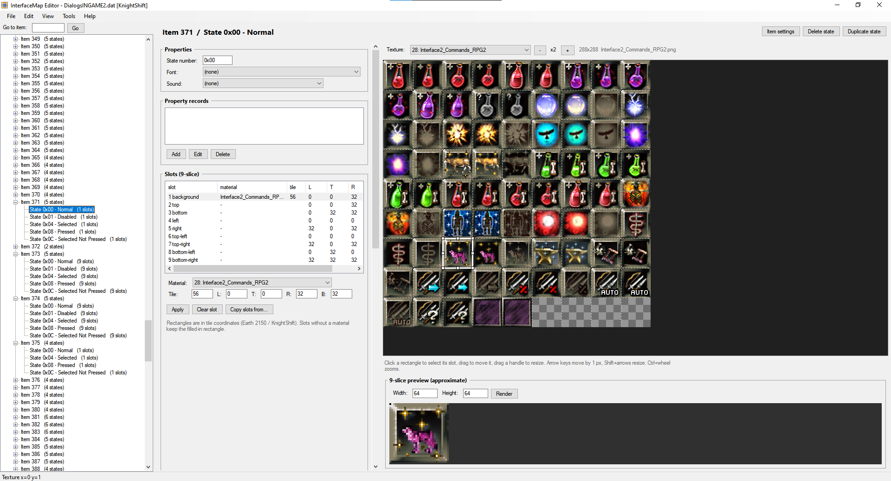
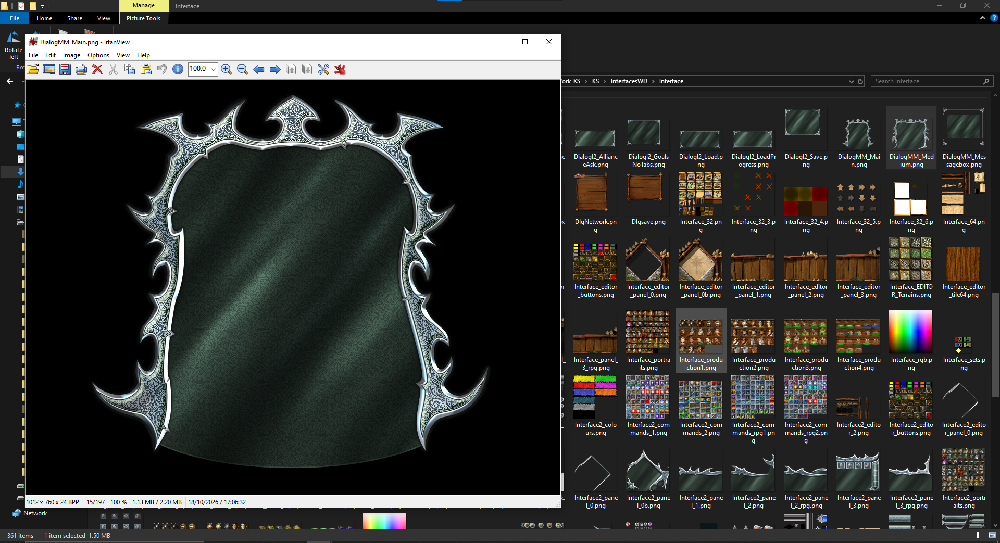
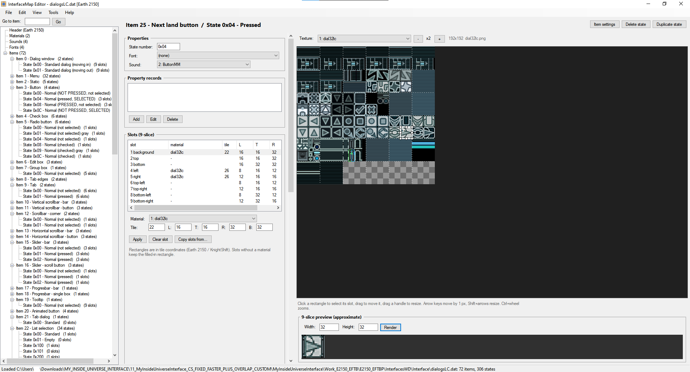
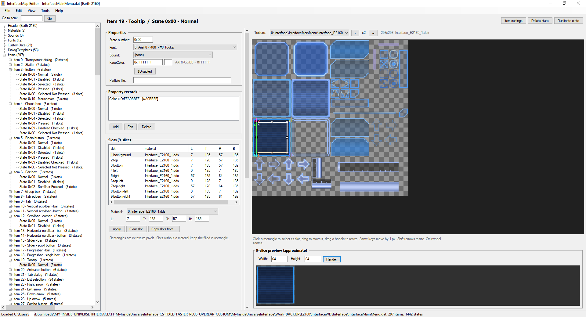
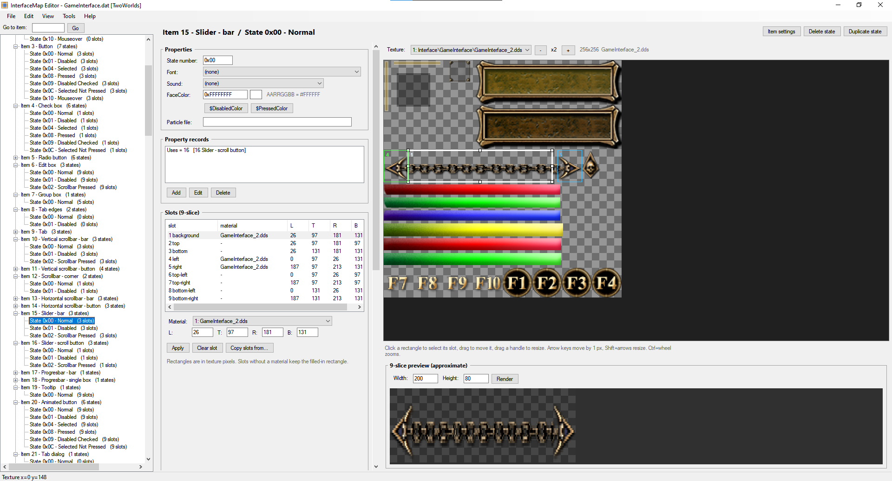
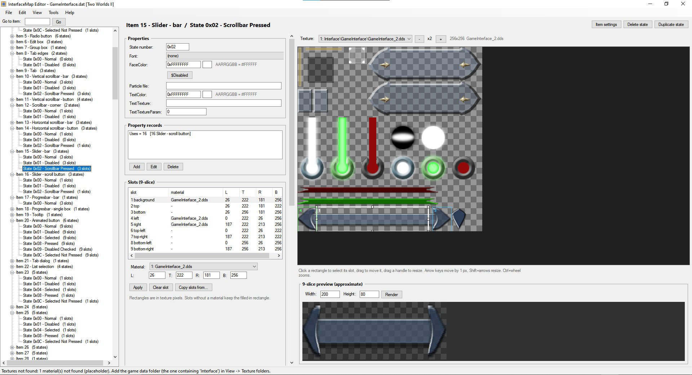
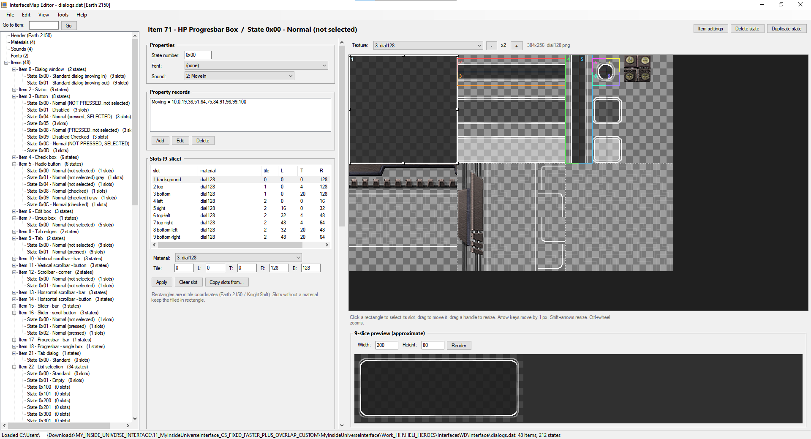
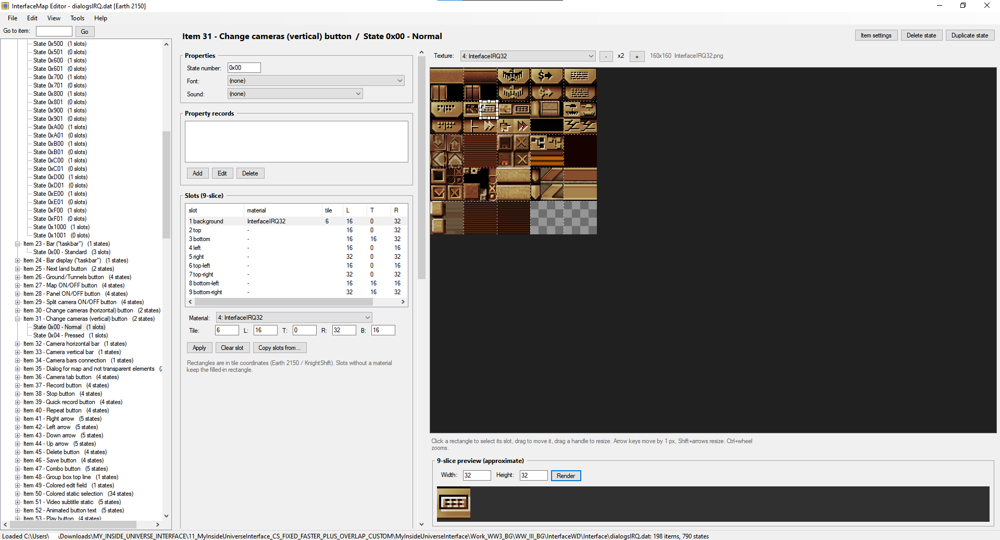
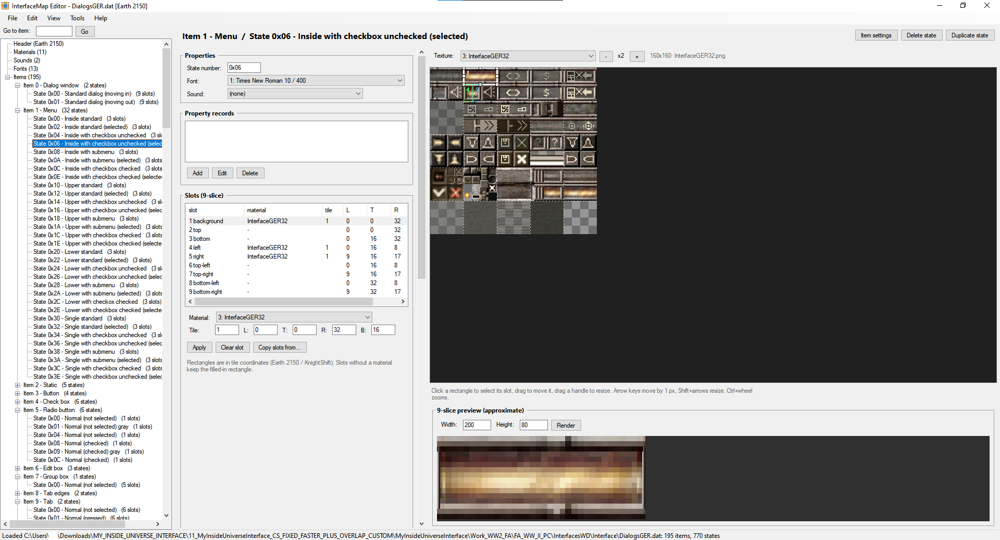

# MyInsideUniverseInterface

Editor and tools for the interface files of Reality Pump games: **Earth 2150**, **KnightShift**, **Earth 2160**, **Two Worlds**, **Two Worlds II**, **Heli Heroes**, **World War III: Black Gold** and **World War II: Panzer Claws**. It includes a graphical editor, an InterfaceMap compiler/decompiler (verified byte for byte), DDS and `.int` tools, and a one-click export/import of a whole interface.



## Supported games

| Game | Interface format | `compile` switch |
|---|---|---|
| Earth 2150 (Escape from the Blue Planet, The Moon Project, Lost Souls) | Earth 2150 | (none) |
| Heli Heroes | Earth 2150 | (none) |
| World War III: Black Gold | Earth 2150 | (none) |
| World War II: Panzer Claws / Frontline Attack: War over Europe | Earth 2150 | (none) |
| KnightShift | KnightShift | `--ks` |
| Earth 2160 | Earth 2160 | `--e2160` |
| Two Worlds | TwoWorlds | `--tw` |
| Two Worlds II | Two Worlds II | `--tw2` |

The format of a `.dat` file is detected automatically.

## Features

- **Graphical editor** for the interface layout files (`.dat`): items, states, the 9-slice slots drawn on the real game texture (move and resize them with the mouse), fonts, materials, sounds, CustomData and DialogTemplates, with item and state names from the developers' spreadsheets.
- **InterfaceMap compiler and decompiler:** `.txt` + colour-map bitmaps ↔ `.dat`. A decompiled file compiles back to an identical `.dat`.
- **Export all / Import all:** unpacks a whole interface (`.dat`, `.tex`, `.dds`, `.int`) into editable files with one click, and packs it back.
- **Overlapping tiles are handled for you** (see below).
- **DDS tool** (`.dds` ↔ `.png` + `.json`) and **AddFileInfo** (the header of `.int` files).
- One `.exe`, no installation: it needs only the .NET Framework 4.8, which is part of Windows 10 and 11.

## Quick start

1. Download the release and unpack it. Everything is included and ready to use (`TexEnv.exe` for the `.tex` textures is already in `Bin`).
2. Extract the interface files of the game from its `.wd` archives (usually `Interface.wd` and `InterfaceEx.wd`) into a subfolder of `Work`, **one folder per interface** (e.g. `Work\KnightShift`, `Work\TwoWorlds`).
3. Run `EXPORT_ALL_INTERFACES.bat`. The layouts become `.txt` + bitmaps, the textures become `.png`, and the `.int` files become `.def`.
4. Edit the files: textures in any image editor, layouts with `RUN_INTERFACE_MAP_GUI.bat`.
5. Run `IMPORT_ALL_INTERFACES.bat` to pack everything back into the game formats, then put the files back into the game.

**Keep the original `.tex` files after the export:** the import writes the edited images into them.

## Overlapping tiles

The game stores large interface textures (dialog backgrounds and frames) as many tiles, each with 4 extra pixels that overlap the neighbouring tiles. At runtime the game joins the tiles and cuts off the overlap. After the export you get the finished image: the tiles are already joined and the overlap is removed, so it can be edited right away. The import splits it into overlapping tiles again, in the form the game expects.



The textures that need this are found in the text `.dat` files of the interface (dialog and background definitions). For textures that no `.dat` of the game names, put your own text `.dat` with their paths into `Bin\MISSING_DATS_FOR_OVERLAP` (files for Earth 2150, Heli Heroes, World War III: Black Gold and World War II: Panzer Claws are included).

## Screenshots

<table>
  <tr>
    <td align="center"><br/>Earth 2150</td>
    <td align="center"><br/>Earth 2160</td>
  </tr>
  <tr>
    <td align="center"><br/>Two Worlds</td>
    <td align="center"><br/>Two Worlds II</td>
  </tr>
  <tr>
    <td align="center"><br/>Heli Heroes</td>
    <td align="center"><br/>World War III: Black Gold</td>
  </tr>
  <tr>
    <td align="center"><br/>World War II: Panzer Claws / Frontline Attack</td>
    <td align="center"><br/>KnightShift</td>
  </tr>
</table>

## Package contents

| File / folder | Purpose |
|---|---|
| `EXPORT_ALL_INTERFACES.bat` | exports every interface in `Work` |
| `IMPORT_ALL_INTERFACES.bat` | packs every interface in `Work` back |
| `RUN_INTERFACE_MAP_GUI.bat` | starts the editor |
| `RUN_TEX_EDIT.bat`, `RUN_TEX_EDIT_SHELL.bat`, `RUN_TEX_VIEWER.bat` | start the TexEnv tools for `.tex` textures |
| `Bin\InterfaceTools.exe` | the program (editor and all command line tools) |
| `Bin\TexEnv.exe` | the `.tex` texture tool, used by the export and import |
| `Bin\MISSING_DATS_FOR_OVERLAP\` | your own text `.dat` files: the textures they name are exported / imported with the Overlap tileset commands |
| `Bin\FORMAT.md` | description of the definition files and the `.dat` files |
| `Work\` | put the interface files here, one folder per interface |
| `Source\` | the C# sources |

## Export all / Import all

```
InterfaceTools export-all [WorkFolder] [--no-tex] [--no-dds] [--no-int] [--dry-run] [--tex-timeout S] [--no-pause]
InterfaceTools import-all [WorkFolder] [--mode text|binary] [--no-tex] [--no-map] [--no-dds] [--no-int]
                          [--dry-run] [--tex-timeout S] [--no-pause]
```

The `.bat` files run these commands on the `Work` folder. The same is available in the editor (*Tools → Export all* / *Import all*), with a log window, options and a Cancel button. The default Work folder is `..\Work` next to the program. Without `--no-pause` the program waits for Enter at the end when it runs in its own console window.

**Export** processes every subfolder of the Work folder (at any depth). Each folder is handled on its own, because the Work folder may hold interfaces of several games. The tiles per row and the Overlap textures therefore come only from the text `.dat` files of that folder and its subfolders:

1. `.tex`: TexEnv `getBestWidthFromInterfaceTileset` gives width hints for the decompiler.
2. `.dat`: decompiled into the same folder (`.txt`, colour-map bitmaps `name@.bmp`, `resource.h` / `DialogsResource.h`). Files that are not interface layouts are reported and skipped.
3. Tiles per row of every `.tex`: from the decompiled bitmaps and from the dialog definitions of the text `.dat` files (KnightShift: `dialog Name = Interface\File.tex 1008,756`; tile 256 px, overlap 4 px).
4. `.tex` → `.png`: TexEnv `exportTilesetFromInterface N`, and if that fails, `exportTexToImg 0`. Textures named in the text `.dat` files (e.g. `Interface\DlgGoalsNoTabs.tex`; text after `//` does not count) or in `Bin\MISSING_DATS_FOR_OVERLAP` use `exportTilesetFromInterfaceOverlap N` instead. From `MISSING_DATS_FOR_OVERLAP` only the texture names are taken, not the tiles per row.
5. `.int` → `.def` (the content, with CRLF) + `.addfileinfo` (the header: name, attrib, GUID).
6. At the end, all `.dds` files of the Work folder → `.png` + `.json`.

**Import** processes the Work folder and all its subfolders:

1. `.def` + `.addfileinfo` → `.int`. A `mode: text|binary` line in the `.addfileinfo` file overrides `--mode` (default: text, i.e. CRLF → LF).
2. `.tex` + `.png` → `.tex`: TexEnv `importTilesetToInterface` (`importTilesetToInterfaceOverlap` for the same textures as in the export), and if that fails, `importImgToTex 0`.
3. `.txt` → `.dat`: the format comes from the `// Format:` line in the header of the `.txt` (written by the decompiler). A `.txt` without it is not an interface definition and is skipped.
4. At the end, all `.json` + `.png` → `.dds`.

TexEnv is run with a temporary script file in the TEMP folder, with all paths in quotes. The log ends with a summary of the files that failed or were skipped, and the exit code is 0 only when everything succeeded.

## Graphical editor

Double-click `InterfaceTools.exe` (or run `RUN_INTERFACE_MAP_GUI.bat`). A `.dat` or `.txt` file dropped onto the program or onto its window is opened. The editor works directly on the contents of the `.dat` file, so no colour-map bitmaps are needed.

- **Tree on the left:** header, materials, sounds, fonts, CustomData, DialogTemplates and all items with their states, with names such as *Item 3 - Button* / *State 0x10 - Mouseover* (see *Names* below). *Go to item* jumps to an item by number.
- **State editor:**
  - properties (font, sound, property records, FaceColor, particle file, Two Worlds II text colour and texture),
  - the table of the 9 slots of the 9-slice (material, tile, L/T/R/B),
  - the real game texture with the slot rectangles drawn on top. Click a rectangle to select its slot, drag it to move it, and drag a handle to resize it. Arrow keys move the selected slot by 1 pixel, and Shift+arrows resize it. Ctrl+mouse wheel zooms,
  - an approximate 9-slice preview at any size.
- **Items:** flags (ConstX/Y, StretchX/Y, alignment, ScaleBorder, ScaleBackground, Two Worlds II InterfaceSounds/DissTexture), SizeScale and ShowStartTime, and one-click presets from the developers' spreadsheet (`$Transparent`, `$common`, `$ConstXY`, `$Margins4`, ...).
- **Special state sets (Two Worlds):** the buttons `$Special_Skill`, `$Special_Inventory` and `$Special_ScrollInventory` in the item panel add the tinted special states of the developers' spreadsheet (0x20-0x30, and 0x40-0x70 for inventory buttons). Each one is a copy of a base state with its own FaceColor, exactly like `Identity` in the definition file (slots, font, records and particle file are copied, the sound is not).
- **Filled-in rectangles:** the compiler computes the rectangles of slots without a material from the NoLeftBorder..NoBackground settings and the margins. These are not stored in the `.dat`, so the editor detects them from the rectangles and shows them in the item panel. Changing them, or moving a slot that has a material, recalculates the empty slots exactly like the compiler.
- **Items and states:** add, duplicate, delete and renumber. When an item is renumbered, the editor offers to update the references to it in DialogTemplates.
- **Materials, sounds, fonts:** add, rename, reorder and delete. Every reference in the slots and states is updated automatically. Elements that are still in use cannot be deleted.
- **Light presets, fonts, CustomData:** named `Light` settings can be picked from a list (and are recognized in existing records). Each game has its own list, because Two Worlds uses the same names as Earth 2160 with other values (e.g. `$LAnimB`). The face colour presets (`$Disabled`; Two Worlds: `$DisabledColor`, `$PressedColor`) are one click away. Earth 2160 and Two Worlds fonts show their spreadsheet descriptions and the `<F#>` text tags they serve (e.g. "Console", "Dialogs <F0> <F2>"), and CustomData entries show what they do.
- **Records:** `Uses` and `Selection` records show the names of the items they refer to.
- **Colours:** colour fields have a swatch (click it to pick a colour), and the `Color` / `Light` record editor previews its colours. The Earth 2150 format and KnightShift store colours as `0xAABBGGRR` (blue = `0xFFFF0000`), the later games as `0xAARRGGBB`. The editor chooses automatically by the file format (*View → Colour byte order* overrides it).
- **CustomData and DialogTemplates** (Earth 2160 and later): identifiers are shown by name when `resource.h` / `DialogsResource.h` is found next to the `.dat` file, or loaded with *File → Load identifier names*. Double-clicking a control opens its item. In Two Worlds the developers' notes on dialogs and controls are shown too (e.g. *IDC_COMMAND_WEAPONTYPE_6: Crossbow - unused, can be the bow*).
- **Undo / redo:** Ctrl+Z / Ctrl+Y, up to 100 steps.
- **Saving:** Ctrl+S. Before overwriting a file for the first time, the editor keeps a copy with the `.bak` extension. Every save is checked by reading the result back. A file opened and saved without changes is identical to the original.
- **File → Open .txt (compile):** compiles a definition file and opens the result (the format is proposed from the `// Format:` line of the file).
- **File → Export as .txt project:** writes the definition file, bitmaps and `resource.h`.
- **View → Check file:** missing materials, fonts and sounds, repeated items and a write/read check.

### Names

Item and state names come from the built-in names database: the core control types 0–22 (the same in all games), the names of Earth 2150, Earth 2160 and Two Worlds (with the item groups of the developers' spreadsheets), and generic state names (0x00 Normal, 0x10 Mouseover, 0x04 Selected, 0x08 Pressed, 0x01 Disabled, 0x20.. Special: ...). Item 50 (fonts of the `<F#>` text tag) shows which tag each state serves.

Different files of the same game may number their items differently, so the matching version is chosen by the item numbers of the opened file: Earth 2160 as released vs. the newer definition file, Two Worlds PC vs. Xbox 360 (e.g. item 170 *Dialog Commands (bar)* vs. *Dialog XCommands (radial menu)*). Developers' notes (e.g. items possibly used directly by the game code) are shown in the item panel. The decompiler writes them, and the notes on dialog controls, as `//` comments into the definition file.

Heli Heroes, World War III: Black Gold and World War II: Panzer Claws get the Earth 2150 names, because they use its format. If they do not fit, turn them off with *View → Show item and state names*, or use *File → Load item/state names from .txt* to take the names of an original definition file (remembered for that `.dat` file).

### Textures

To show the real textures, the editor looks for the material files (`.dds`, `.tga`, `.png`, `.bmp`) in:

1. the file chosen for a material with *Materials → Set texture file...* (or a double-click on the material),
2. the folders from *View → Texture folders...* (add the game data folder, the one that contains `Interface`),
3. the folder of the opened `.dat` file (or of the `.txt` file opened with *Open .txt*) and up to three parent folders.

If the textures are not found, the status bar says so and the texture view marks the picture as a colour map.

Material paths such as `Interface\GameInterface\GameInterface_1.dds` are resolved relative to these folders, case-insensitively, also with the `Textures\` prefix that Two Worlds uses in its archives (`Interface.wd` unpacks the texture as `Textures\Interface\GameInterface\GameInterface_1.dds` and the `.dat` as `Interface\GameInterface.dat`; unpack all archives into one folder). Real textures are searched in all the folders first. Only if none is found, the colour-map bitmap `name@.bmp` is used, and if that is missing too, a grey placeholder. *View → Show colour maps (name@.bmp) instead of textures* reverses this order, which is handy because a colour map shows the exact area of every slot.

Supported textures: DDS (uncompressed, DXT1/3/5, BC4, BC5), 8/24/32-bit BMP, 24/32-bit TGA and PNG. In the Earth 2150 format and KnightShift the slot rectangles are stored in tile coordinates. The editor converts them to texture pixels and back automatically. The tile size of each material is guessed, and can be changed with *Materials → Tile size...* (an editor setting, not stored in the `.dat`).

Editor settings are stored in `.interfacemap_gui.json` in the user's home folder.

## Command line

```
InterfaceTools compile [--ks | --e2160 | --tw | --tw2] dialogs.txt dialogs.dat
InterfaceTools decompile dialogs.dat [output_folder] [--resource resource.h] [--names original.txt | --no-names]
               [--tile name=pixels ...] [--width pixels] [--width name=pixels ...] [--format f]
InterfaceTools dump dialogs.dat
InterfaceTools diff old.dat new.dat [--resource resource.h] [--names original.txt] [--brief]
InterfaceTools dds export|import|create|info|formats ...      (InterfaceTools dds --help)
InterfaceTools addfileinfo <source> <dest> [-text|-binary] [-name N] [-attrib V] [-guid G | -guidCreate | -guidNone]
InterfaceTools addfileinfo -extract <file.int> <output> [-crlf]
InterfaceTools tiles DAT_DIR [TEXTURE_NAME] [--tex FILE.tex] [--csv FILE]  /  tiles DAT_DIR --textures
InterfaceTools export-all ... / import-all ...                 (see above)
InterfaceTools edit [file.dat]                                 (the editor)
```

Paths are relative to the current folder, and paths with spaces must be quoted. Output redirected to a file (`InterfaceTools dump x.dat > report.txt`) goes into the file.

- The compiler looks for the bitmaps and `resource.h` / `DialogsResource.h` **next to the `.txt` file** first, and then in the current folder.
- `decompile` without an output folder writes into `<name>_src` next to the `.dat` file, and looks for the identifier file next to the `.dat` file and in the current folder.
- `tiles` prints the tile layout of the `.tex` textures defined in the text `.dat` files; `--tex` checks it against the header of a `.tex` file; `--textures` lists the `.tex` files named in the text `.dat` files (the textures that use the Overlap commands).

**Export every `.dat` file into its own folder.** The bitmaps are named after the materials (e.g. `GameInterface_1@.bmp`), not after the `.dat` file. Two files with the same materials (Two Worlds PC and Xbox, two versions of one file) exported into one folder would overwrite each other's bitmaps (and `resource.h`); the decompiler warns when that happens. It also writes `// Bitmap <name> crc32 0x...` comment lines into the definition file. The compiler checks them, warns when a bitmap is not the one written together with the `.txt` (edited or replaced), and looks for the right one in the subfolders and the parent folder. An error such as *Some rects remain undefined* names the missing colour and lists the colours found on every bitmap.

For the Earth 2150 format and KnightShift, `--tile` and `--width` control the layout of the generated bitmaps: the number of tiles per row is `width / tile size`. This layout is not stored in the `.dat` file (it depends on the real game texture), so by default the width is 256 px. `--width 512` sets the default for all bitmaps, `--width dial64JS=512` sets it for one material only, and both forms can be combined. The generated files always compile back to an identical `.dat`, whatever layout is chosen.

### DDS tool

`dds export` writes a `.png` (the largest mip level) and a `.json` next to every `.dds`; `dds import` rebuilds the `.dds` from them and generates the mip maps (box filter, in linear light for sRGB formats). The `.json` has three sections: `editable` (format, mip maps, ...), `info` (read-only details) and `do_not_edit` (header fields needed to rebuild the file exactly). Supported are the formats of the Reality Pump games: uncompressed formats up to 16 bits per channel, DXT1/DXT3/DXT5, BC4 and BC5. BC6H, BC7 and floating-point formats are reported as not supported. `dds formats` lists them; `dds create image.png -f DXT5 -o out.dds` makes a new file (`--like other.dds` copies the format of another file).

### .int files (AddFileInfo)

An `.int` file is a text file with a small header (name, attribute, GUID). `export-all` writes the content as `.def` and the header as `.addfileinfo`:

```
name: Interface\Dialogs.int
attrib: (none)
guid: 943B5D94-BD56-49E1-A8AF-0A97DEDF0366
```

`import-all` puts them back together. `guid: create` makes a new GUID, `(none)` leaves a section out, and an optional `mode: binary` line stores the content without converting CRLF to LF.

## Building from source

The sources are in `Source` (C#, .NET Framework 4.8, Windows Forms).

- **Windows:** install the .NET SDK and run `Source\build.cmd` (`dotnet build -c Release`). The result is `Source\bin\Release\InterfaceTools.exe`.
- **Linux:** `Source/build.sh` builds it with the Roslyn compiler of the .NET SDK and the reference assemblies of Mono.

See [`Bin/FORMAT.md`](Bin/FORMAT.md) for the syntax of the definition files and the structure of the `.dat` files.

## Disclaimer

This is a fan project, not affiliated with Reality Pump or the publishers of these games. No game files are included: use the files of your own copy of the game.
